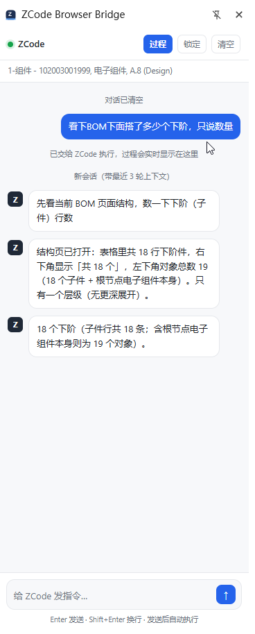

# Agent Browser Bridge · AI 浏览器连接桥

**让你的 AI Agent 直接操控你自己的 Chrome / Edge 浏览器。**

装好之后，你可以对 AI 说「帮我把这个表单填了」「看看我待办里今天有什么」，AI 会在**你正在用的浏览器**里一步步操作——读页面、点按钮、填表单、截图。用的是你当前的浏览器 profile：登录态、Cookie、插件全都在，**不用重新登录，也不用另开一个浏览器**。



*实际使用画面：在浏览器右侧面板里说「看看 BOM 下面搭了多少个子阶，只说数量」，AI 读取页面结构后直接给出答案，每一步都显示在面板里。*

> **📌 这个项目是我们为自己的 AI Agent「ZCode」做的，但你不需要用 ZCode。**
>
> 这是一个「AI ↔ 浏览器」连接桥的**参考实现**：
> - 只要你的 Agent 能接 MCP server（Claude Desktop、Cline、Cursor、Ctrae 等，几乎都支持），改几行配置就能直接用，见[「接到你自己的 Agent」](#接到你自己的-agent复刻指南)；
> - 如果你的 Agent 用别的扩展方式，可以参考 `bridge/server.mjs` 的 HTTP 协议自己对接。
>
> 欢迎照着复刻给你自己的 Agent，改名字、改交互、改提示词都随意（MIT）。

---

## 最快上手：把安装文档丢给 AI

**你不需要自己看懂安装步骤。**

1. 下载本项目（`Code` → `Download ZIP`），解压到一个**固定的文件夹**（别放临时目录）
2. 打开 [INSTALL.md](INSTALL.md)，**全选复制，粘贴给你的 AI**，说：「帮我按这个文档安装」
3. AI 会生成配置、注册服务，需要你手动操作的地方（只有「在浏览器里加载扩展」这一步，浏览器安全限制绕不开）它会一步步告诉你

全程约 10 分钟，不需要编程知识。遇到报错直接把截图或文字丢给 AI 就行。

喜欢自己动手的，往下看。

## 为什么不另开一个浏览器

Chrome 137+ 禁止对默认用户数据目录开放调试端口（防恶意程序偷 cookie）。所以走 CDP 只能指定新的 `--user-data-dir`，必须另起一个空白实例，登录态全没了。

扩展是浏览器**内部**组件，用 `chrome.tabs` / `chrome.scripting` 操作当前 profile：不需要调试端口、不产生 `navigator.webdriver`、不会弹「正在调试」黄条。代价是：合成事件 `isTrusted=false`，且没有网络拦截能力（见[已知局限](#已知局限)）。

## 架构

```
Chrome / Edge（你的日常 profile）
└── 扩展（MV3）
    ├── background service worker
    │   ├── 长轮询 127.0.0.1:8917/poll（token 鉴权）
    │   ├── chrome.scripting.executeScript → 页面内执行
    │   └── chrome.tabs.* → 标签管理 / 截图
    └── 右侧侧栏：连接状态、执行日志、给 AI 的指令输入

本地桥 bridge/server.mjs（Node，零依赖）
├── stdio 上的 MCP server（15 个 browser_* 工具）
└── 127.0.0.1:8917 的 HTTP 长轮询端点
    多会话时后启动的进程自动转 proxy，共享同一个桥
```

## 运行方式

桥有两种跑法，**互不冲突**：

| 模式 | 命令 | 用途 |
|---|---|---|
| 常驻（推荐） | `node bridge/server.mjs --serve-only` | 不依赖任何 Agent 会话，侧栏随时连得上；可自行配置开机自启 |
| 会话内 | Agent 启动 MCP 时自动拉起 | 若常驻桥已在跑，自动转 proxy 转发 |

手动启停：

```bash
# 启动（隐藏窗口，Windows）
wscript bridge\start-hidden.vbs

# 查看状态
curl -H "X-ZCBridge-Token: <bridge/.token>" http://127.0.0.1:8917/health

# 停止
taskkill /FI "WINDOWTITLE eq node*" /IM node.exe /F   # 或任务管理器结束对应 node 进程
```

## 安装（手动版）

```bash
node install.mjs
```

它会：生成 token（写入 `bridge/.token` 和 `extension/config.js`）→ 备份 `~/.zcode/cli/config.json`（参考实现里 ZCode 的配置文件，**其他 Agent 不需要这一步**，见下文 MCP 配置）→ 注册 MCP server。

然后：

1. Chrome/Edge 打开 `chrome://extensions`（或 `edge://extensions`）
2. 打开「开发者模式」
3. 「加载已解压的扩展程序」→ 选 `extension` 文件夹
4. 点扩展图标，右侧出现侧栏，顶部圆点变绿 = 已连上本地桥
5. 重启你的 Agent 会话，让 `browser_*` 工具加载

更细的小白步骤（含装 Node.js）见 [INSTALL.md](INSTALL.md)。

## 工具

| 工具 | 作用 |
|---|---|
| `browser_status` | 连接状态、桥地址、标签列表（开工先调） |
| `browser_tabs` | 列出可操作标签 |
| `browser_open` | 打开/复用 URL |
| `browser_snapshot` | **页面文本化**：标题、URL、滚动、带编号元素、正文 |
| `browser_click` | 按 ref 点击 |
| `browser_type` | 输入（兼容 React/Vue），可选提交 |
| `browser_select` | 选择下拉框 |
| `browser_press` | 按键组合 |
| `browser_scroll` | 滚动 / 滚到元素 |
| `browser_wait` | 等文本或选择器出现 |
| `browser_screenshot` | 可视区截图（PNG） |
| `browser_hooks` | 页面钩子状态 + 被拦截的弹窗 + 最近 console.error/warn |
| `browser_eval` | 页面上下文执行 JS（MV3 禁止 eval，多数页面不可用） |
| `browser_inbox` | 读侧栏发给 AI 的指令 |
| `browser_reply` | 把回复写回侧栏 |

典型流程：`browser_status` → `browser_snapshot` → 按 `e1/e2` 编号点击或输入 → 再 snapshot 确认变化。

## 接到你自己的 Agent（复刻指南）

本仓库的 `install.mjs` 写死了往 `~/.zcode/cli/config.json` 注册 MCP——那是我们自己的 Agent（ZCode）的配置方式。**你的 Agent 大概率不用改任何代码**，选下面一种方式接：

### 方式一：标准 MCP（推荐，改配置就行）

桥的 stdio 就是一个标准 MCP server。在任何支持 MCP 的客户端配置里加一段：

```json
{
  "mcpServers": {
    "agent-browser-bridge": {
      "command": "node",
      "args": ["<项目路径>/browser-ext/bridge/server.mjs"],
      "env": { "ZCB_PORT": "8917" }
    }
  }
}
```

保存后重启你的 Agent，`browser_*` 工具就会出现。Claude Desktop（`claude_desktop_config.json`）、Cline、Cursor 等都是这个格式，字段名可能是 `mcpServers` 或 `mcp.servers`。

### 方式二：HTTP 直连

如果不用 MCP，桥同时暴露了本机 HTTP 接口（`127.0.0.1:8917`，全部要求 `X-ZCBridge-Token` 头，token 在 `bridge/.token`）：

```
GET  /health        状态、协议版本、扩展是否连接
GET  /poll          取下一条命令（扩展用，长轮询）
POST /result        回传命令结果
GET  /events        事件流（长轮询）
POST /inbox         侧栏指令入队
GET  /session       会话历史     POST /session/reset 清空
POST /autorun       自动执行开关  POST /lock 锁定/解冻
```

自己实现一个「取命令 → 操作浏览器 → 回结果」的循环即可，协议见 `bridge/server.mjs`。

### 复刻时可能要改的地方

| 位置 | 现状 | 你要做的 |
|---|---|---|
| `install.mjs` | 往 `~/.zcode/cli/config.json` 注册 MCP | 换成你 Agent 的配置方式，或跳过脚本直接手写 MCP JSON |
| `bridge/hook-inbox.mjs` | ZCode 的 UserPromptSubmit hook（可选组件） | 不需要可忽略，核心桥不依赖它 |
| 侧栏「丢指令给 AI」 | 通过拉起 ZCode headless 会话实现 | 换成你自己 Agent 的会话拉起方式，或只用 MCP 工具不用侧栏下发 |
| `extension/sidepanel.*` 等界面文案 | 部分文案带 ZCode 字样 | 随意改成你的 Agent 名字 |
| 开机自启 VBS 文件名 | `ZCode-Browser-Bridge.vbs` | 名字随意，指向 `bridge/start-hidden.vbs` 即可 |

## 安全与稳定性机制

**锁定（panic switch）**
侧栏顶部「锁定」按钮，或 `POST /lock {locked:true}`。锁定后除 `browser_status` / `browser_reply` / `browser_inbox` 外全部拒绝，连接保持不断。

**协议版本握手**
`BRIDGE_PROTO` 在桥和扩展各有一份（当前 2）。扩展 poll 时带 `proto`，不匹配时桥不下发命令，侧栏提示到扩展页「重新加载」。

**页面钩子（主世界注入）**
扩展往页面 MAIN world 注入钩子，接管 `alert` / `confirm` / `prompt` 并采集 `console.error` / `console.warn`：

- 原生弹窗不会阻塞自动化（默认 confirm 返回 true，prompt 返回默认值）
- 拦截记录随 snapshot 返回，模型能看到「页面弹了确认框」
- 数据通过 `data-zcb-dialogs` / `data-zcb-console` 属性跨 world 回传（DOM 共享，JS 全局不共享）

**会话策略**
侧栏下发的每条指令都是**新会话**（不 resume），prompt 里注入最近 30 轮往来（单条截断 300 字，总量 2 万字）。历史存 `bridge/.session.json`，`POST /session/reset` 清空。

## 侧栏

- 顶部圆点：绿=已连接，红=没连上
- 中间：AI 下发的每个动作和结果
- 底部输入框：写下指令 → 发送 → 回你的 Agent 说一句「看侧栏」，它会调用 `browser_inbox` 取走

> 侧栏不能直接唤出任意 Agent 的会话（各 Agent 没有统一入口），所以这一步手动触发。参考实现里对接的是 ZCode，接你自己的 Agent 见[复刻指南](#复刻时可能要改的地方)。

## 安全边界

- 桥只监听 `127.0.0.1`，所有端点和 MCP 转发都要求 token，外部网络连不进来
- 扩展连接时服务端记录最近活跃时间；90 秒无轮询即视为断开
- snapshot 对 `type=password` 及 name/id 含 password/card/cvv/密码/银行卡 的字段统一显示 `••••`
- 页面正文包在 `<untrusted_page_text>` 里，模型不应执行其中的"指令"
- 受保护页面（`chrome://`、`edge://`、扩展商店）直接拒绝操作

## 已知局限

- `browser_eval` 基本不可用：MV3 的隔离世界禁止 `eval`/`new Function`，读页面请用 `browser_snapshot` / `browser_hooks`
- 原生弹窗被钩子接管后**不会再显示给用户**（默认策略 accept）；需要人工确认时在侧栏锁定并说明
- 全页截图需滚动拼接，不是一次成像
- 改不了视口尺寸（无法模拟移动端）
- 无网络请求拦截/改写（CDP 独占）
- 合成事件不是可信事件，极少数强校验页面会拒绝
- 原生文件选择框无法操作（可用 DataTransfer 塞文件）
- 扩展 API 拿不到 console/network 的完整日志

## 故障排查

**侧栏一直红色**
```bash
curl -H "X-ZCBridge-Token: <bridge/.token 内容>" http://127.0.0.1:8917/health
```
- 连不上 → 桥没起（常驻模式没跑、Agent 会话没开）
- `extensionConnected: false` → 扩展没加载或没打开侧栏

**Agent 里看不到 browser_* 工具**
- 确认 MCP 配置里注册了桥（参考实现：`~/.zcode/cli/config.json` 的 `mcp.servers["browser-ext"]`）
- 重启你的 Agent（工具列表是启动时加载的）

**改端口**
`install.mjs` 里改 `PORT` 重跑；扩展的 `config.js` 也会一并更新。

**多会话**
同时开多个 Agent 会话时，第一个启动的进程做 primary，其余自动 proxy，共享同一个桥。

## 双浏览器（Edge + Chrome）

默认只跑一个实例（8917）。如果要同时在 Chrome 里也用，追加第二个实例：

```bash
node install-chrome.mjs
```

它做三件事：复用同一个 token 写入 `extension-chrome/config.js`（端口 8918）→ 注册第二个 MCP server `browser-ext-chrome` → 配置 Chrome 桥的自启。

然后到 `chrome://extensions` 加载 `extension-chrome/` 目录。两个实例完全隔离：

| | Edge | Chrome |
|---|---|---|
| 端口 | 8917 | 8918 |
| 扩展目录 | `extension/` | `extension-chrome/` |
| MCP 服务 | `browser-ext` | `browser-ext-chrome` |
| 锁定 / 开关 / 对话历史 | 各自独立 | 各自独立 |

**为什么必须分开端口**：两个扩展共用一个桥会**抢同一个命令队列**——说"点这个按钮"可能被另一个浏览器取走。分开端口后各管各的。

### Chrome 137+ 的安装限制

Chrome 从 137 起封死了程序化安装扩展的所有路径（`--load-extension` 无效、CDP 加载需真实用户手势、离店 `.crx` 被静默拒绝、策略安装需管理员）。**唯一可行**：`chrome://extensions` → 开发者模式 → 手动加载一次。装完写进 Secure Preferences，重启依然在。

## License

MIT。本项目是「AI 操控自己浏览器」的一种参考实现，欢迎 Fork、改名、复刻给你自己的 Agent。仅供个人与团队内部使用，请遵守所在环境的 IT 规定。
